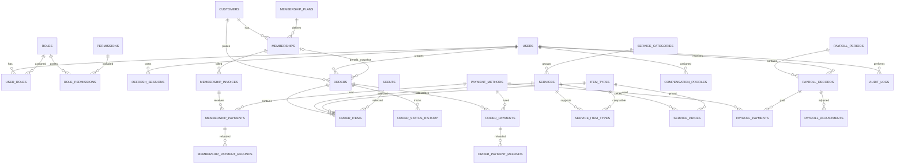

# Entity Relationship Diagram — Laundry Management System

**Version:** 1.2  
**Status:** V1 logical database baseline  
**Database:** PostgreSQL  
**ORM:** Prisma  
**ID:** UUID  
**Timestamp:** `TIMESTAMPTZ` in UTC

## 1. Design decisions

- One `customers` table for members and non-members.
- Membership is a separate entity.
- Customers do not need user accounts.
- Every order references one customer.
- New guest customer and order are created transactionally.
- Phone numbers are indexed but not unique.
- Order items preserve historical snapshots.
- Membership payments, order payments and payroll payments are separate.
- Financial values use `NUMERIC`.
- Historical records are not hard-deleted.

## 2. ERD



## 3. Table definitions

### 3.1 Users and RBAC

#### `users`

| Column         | Type         | Constraint            |
| -------------- | ------------ | --------------------- |
| id             | UUID         | PK                    |
| username       | VARCHAR(100) | UNIQUE, NOT NULL      |
| password_hash  | TEXT         | NOT NULL              |
| full_name      | VARCHAR(150) | NOT NULL              |
| phone          | VARCHAR(30)  | NULL                  |
| is_active      | BOOLEAN      | NOT NULL DEFAULT true |
| created_at     | TIMESTAMPTZ  | NOT NULL              |
| updated_at     | TIMESTAMPTZ  | NOT NULL              |
| deactivated_at | TIMESTAMPTZ  | NULL                  |

#### `roles`

`id UUID PK`, `code VARCHAR(50) UNIQUE`, `name VARCHAR(100)`, `description TEXT`.

Seed codes: `SUPERADMIN`, `ADMIN`, `EMPLOYEE`.

#### `permissions`

`id UUID PK`, `code VARCHAR(100) UNIQUE`, `description TEXT`.

#### `user_roles`

`user_id UUID FK users`, `role_id UUID FK roles`, `assigned_at TIMESTAMPTZ`, `assigned_by UUID FK users NULL`.

Composite primary key: `(user_id, role_id)`.

#### `role_permissions`

`role_id UUID FK roles`, `permission_id UUID FK permissions`.

Composite primary key: `(role_id, permission_id)`.

#### `refresh_sessions`

| Column          | Type             |
| --------------- | ---------------- |
| id              | UUID PK          |
| user_id         | UUID FK users    |
| token_hash      | TEXT             |
| token_family_id | UUID             |
| expires_at      | TIMESTAMPTZ      |
| revoked_at      | TIMESTAMPTZ NULL |
| created_at      | TIMESTAMPTZ      |
| last_used_at    | TIMESTAMPTZ NULL |

Never store raw refresh tokens.

---

### 3.2 Customers and memberships

#### `customers`

| Column           | Type         | Constraint      |
| ---------------- | ------------ | --------------- |
| id               | UUID         | PK              |
| name             | VARCHAR(150) | NOT NULL        |
| phone            | VARCHAR(30)  | NOT NULL        |
| normalized_phone | VARCHAR(30)  | NOT NULL, INDEX |
| whatsapp         | VARCHAR(30)  | NULL            |
| address          | TEXT         | NULL            |
| notes            | TEXT         | NULL            |
| created_by       | UUID         | FK users, NULL  |
| created_at       | TIMESTAMPTZ  | NOT NULL        |
| updated_at       | TIMESTAMPTZ  | NOT NULL        |
| deactivated_at   | TIMESTAMPTZ  | NULL            |

**Do not make `normalized_phone` unique.** A phone number is searchable contact data, not a customer identity key.

Indexes:

- `customers.normalized_phone`
- `customers.name`

#### `membership_plans`

| Column        | Type          |
| ------------- | ------------- |
| id            | UUID PK       |
| name          | VARCHAR(150)  |
| description   | TEXT NULL     |
| duration_days | INTEGER       |
| price         | NUMERIC(14,2) |
| is_active     | BOOLEAN       |
| created_at    | TIMESTAMPTZ   |
| updated_at    | TIMESTAMPTZ   |

V1 membership plans are one-time plans. Benefits should be added as explicit fields or related benefit tables after business rules are approved.

#### `memberships`

| Column             | Type                     |
| ------------------ | ------------------------ |
| id                 | UUID PK                  |
| customer_id        | UUID FK customers        |
| membership_plan_id | UUID FK membership_plans |
| status             | VARCHAR(30)              |
| started_at         | TIMESTAMPTZ NULL         |
| expires_at         | TIMESTAMPTZ NULL         |
| activated_at       | TIMESTAMPTZ NULL         |
| cancelled_at       | TIMESTAMPTZ NULL         |
| created_by         | UUID FK users            |
| created_at         | TIMESTAMPTZ              |
| updated_at         | TIMESTAMPTZ              |

Statuses: `PENDING`, `ACTIVE`, `EXPIRED`, `CANCELLED`, `SUSPENDED`.

One active membership per customer:

```sql
CREATE UNIQUE INDEX memberships_one_active_per_customer
ON memberships (customer_id)
WHERE status = 'ACTIVE';
```

The application must also validate that the membership is within its effective dates.

#### `membership_invoices`

| Column                 | Type                |
| ---------------------- | ------------------- |
| id                     | UUID PK             |
| membership_id          | UUID FK memberships |
| invoice_number         | VARCHAR(50) UNIQUE  |
| plan_name_snapshot     | VARCHAR(150)        |
| duration_days_snapshot | INTEGER             |
| amount                 | NUMERIC(14,2)       |
| status                 | VARCHAR(30)         |
| issued_at              | TIMESTAMPTZ         |
| paid_at                | TIMESTAMPTZ NULL    |
| due_at                 | TIMESTAMPTZ NULL    |
| created_at             | TIMESTAMPTZ         |

V1 does not need recurring billing period fields. Add them when recurring memberships are introduced.

#### `membership_payments`

| Column                | Type                        |
| --------------------- | --------------------------- |
| id                    | UUID PK                     |
| membership_invoice_id | UUID FK membership_invoices |
| payment_method_id     | UUID FK payment_methods     |
| amount                | NUMERIC(14,2)               |
| status                | VARCHAR(30)                 |
| reference_number      | VARCHAR(150) NULL           |
| paid_at               | TIMESTAMPTZ NULL            |
| received_by           | UUID FK users               |
| idempotency_key       | VARCHAR(150)                |
| created_at            | TIMESTAMPTZ                 |

For V1, membership activation requires full invoice payment. The service must reject an incomplete payment.

#### `membership_payment_refunds`

| Column                | Type                        |
| --------------------- | --------------------------- |
| id                    | UUID PK                     |
| membership_payment_id | UUID FK membership_payments |
| amount                | NUMERIC(14,2)               |
| reason                | TEXT                        |
| status                | VARCHAR(30)                 |
| refunded_at           | TIMESTAMPTZ NULL            |
| refunded_by           | UUID FK users               |
| idempotency_key       | VARCHAR(150)                |
| created_at            | TIMESTAMPTZ                 |

---

### 3.3 Services and pricing

#### `service_categories`

`id UUID PK`, `name VARCHAR(100) UNIQUE`, `description TEXT NULL`, `is_active BOOLEAN`.

#### `services`

`id UUID PK`, `service_category_id UUID FK`, `name VARCHAR(150)`, `description TEXT NULL`, `is_active BOOLEAN`, `created_at TIMESTAMPTZ`, `updated_at TIMESTAMPTZ`.

#### `item_types`

`id UUID PK`, `name VARCHAR(100) UNIQUE`, `description TEXT NULL`, `is_active BOOLEAN`.

#### `service_item_types`

`service_id UUID FK services`, `item_type_id UUID FK item_types`.

Composite primary key: `(service_id, item_type_id)`.

#### `scents`

`id UUID PK`, `code VARCHAR(50) UNIQUE`, `name VARCHAR(100)`, `is_active BOOLEAN`.

#### `service_prices`

| Column         | Type               |
| -------------- | ------------------ |
| id             | UUID PK            |
| service_id     | UUID FK services   |
| item_type_id   | UUID FK item_types |
| unit           | VARCHAR(20)        |
| price          | NUMERIC(14,2)      |
| effective_from | TIMESTAMPTZ        |
| effective_to   | TIMESTAMPTZ NULL   |
| created_by     | UUID FK users      |
| created_at     | TIMESTAMPTZ        |

No overlapping effective periods for the same `(service_id, item_type_id, unit)`. Use a PostgreSQL exclusion constraint or a concurrency-safe migration-backed database solution.

#### `payment_methods`

`id UUID PK`, `code VARCHAR(50) UNIQUE`, `name VARCHAR(100)`, `is_active BOOLEAN`.

---

### 3.4 Orders

#### `orders`

| Column                        | Type          | Constraint              |
| ----------------------------- | ------------- | ----------------------- |
| id                            | UUID          | PK                      |
| order_number                  | VARCHAR(50)   | UNIQUE                  |
| customer_id                   | UUID          | FK customers            |
| membership_id_snapshot        | UUID          | Nullable FK memberships |
| membership_plan_name_snapshot | VARCHAR(150)  | NULL                    |
| received_at                   | TIMESTAMPTZ   | NOT NULL                |
| expected_completion_at        | TIMESTAMPTZ   | NULL                    |
| status                        | VARCHAR(30)   | NOT NULL                |
| subtotal                      | NUMERIC(14,2) | NOT NULL                |
| discount_amount               | NUMERIC(14,2) | NOT NULL DEFAULT 0      |
| tax_amount                    | NUMERIC(14,2) | NOT NULL DEFAULT 0      |
| total_amount                  | NUMERIC(14,2) | NOT NULL                |
| notes                         | TEXT          | NULL                    |
| created_by                    | UUID          | FK users                |
| created_at                    | TIMESTAMPTZ   | NOT NULL                |
| updated_at                    | TIMESTAMPTZ   | NOT NULL                |
| cancelled_at                  | TIMESTAMPTZ   | NULL                    |
| cancellation_reason           | TEXT          | NULL                    |

`membership_id_snapshot` and `membership_plan_name_snapshot` are nullable. They preserve which membership was considered when the order was created. If V1 does not apply membership benefits, the fields still provide useful historical context; alternatively, defer them until benefits are implemented.

#### `order_items`

| Column                  | Type                |
| ----------------------- | ------------------- |
| id                      | UUID PK             |
| order_id                | UUID FK orders      |
| service_id              | UUID FK services    |
| item_type_id            | UUID FK item_types  |
| scent_id                | UUID FK scents NULL |
| service_name_snapshot   | VARCHAR(150)        |
| item_type_name_snapshot | VARCHAR(100)        |
| scent_name_snapshot     | VARCHAR(100) NULL   |
| quantity                | NUMERIC(12,3)       |
| unit                    | VARCHAR(20)         |
| unit_price              | NUMERIC(14,2)       |
| line_total              | NUMERIC(14,2)       |
| notes                   | TEXT NULL           |
| created_at              | TIMESTAMPTZ         |

#### `order_status_history`

`id UUID PK`, `order_id UUID FK`, `previous_status VARCHAR(30) NULL`, `new_status VARCHAR(30)`, `notes TEXT NULL`, `changed_by UUID FK users`, `changed_at TIMESTAMPTZ`.

#### `order_payments`

`id UUID PK`, `order_id UUID FK`, `payment_method_id UUID FK`, `amount NUMERIC(14,2)`, `status VARCHAR(30)`, `reference_number VARCHAR(150) NULL`, `paid_at TIMESTAMPTZ NULL`, `received_by UUID FK users`, `idempotency_key VARCHAR(150)`, `created_at TIMESTAMPTZ`.

#### `order_payment_refunds`

`id UUID PK`, `order_payment_id UUID FK`, `amount NUMERIC(14,2)`, `reason TEXT`, `status VARCHAR(30)`, `refunded_at TIMESTAMPTZ NULL`, `refunded_by UUID FK users`, `idempotency_key VARCHAR(150)`, `created_at TIMESTAMPTZ`.

Payment summaries should be derived from payment and refund records initially. Add denormalized summary columns only if performance requires them and they can be updated transactionally.

---

### 3.5 Payroll

#### `compensation_profiles`

`id UUID PK`, `employee_id UUID FK users`, `compensation_type VARCHAR(30)`, `base_amount NUMERIC(14,2)`, `effective_from TIMESTAMPTZ`, `effective_to TIMESTAMPTZ NULL`, `is_active BOOLEAN`.

#### `payroll_periods`

`id UUID PK`, `name VARCHAR(100)`, `start_date DATE`, `end_date DATE`, `status VARCHAR(30)`, `created_by UUID FK users`, `created_at TIMESTAMPTZ`.

#### `payroll_records`

| Column            | Type                    |
| ----------------- | ----------------------- |
| id                | UUID PK                 |
| payroll_period_id | UUID FK payroll_periods |
| employee_id       | UUID FK users           |
| base_amount       | NUMERIC(14,2)           |
| bonus_amount      | NUMERIC(14,2)           |
| deduction_amount  | NUMERIC(14,2)           |
| adjustment_amount | NUMERIC(14,2)           |
| net_amount        | NUMERIC(14,2)           |
| status            | VARCHAR(30)             |
| generated_by      | UUID FK users           |
| approved_by       | UUID FK users NULL      |
| approved_at       | TIMESTAMPTZ NULL        |
| created_at        | TIMESTAMPTZ             |
| updated_at        | TIMESTAMPTZ             |

Unique constraint: `(payroll_period_id, employee_id)`.

#### `payroll_adjustments`

`id UUID PK`, `payroll_record_id UUID FK`, `adjustment_type VARCHAR(30)`, `amount NUMERIC(14,2)`, `reason TEXT`, `created_by UUID FK users`, `created_at TIMESTAMPTZ`.

#### `payroll_payments`

`id UUID PK`, `payroll_record_id UUID FK`, `payment_method_id UUID FK`, `amount NUMERIC(14,2)`, `status VARCHAR(30)`, `reference_number VARCHAR(150) NULL`, `paid_at TIMESTAMPTZ NULL`, `paid_by UUID FK users`, `idempotency_key VARCHAR(150)`, `created_at TIMESTAMPTZ`.

---

### 3.6 Audit logs

#### `audit_logs`

| Column        | Type               |
| ------------- | ------------------ |
| id            | UUID PK            |
| actor_user_id | UUID FK users NULL |
| action        | VARCHAR(100)       |
| entity_type   | VARCHAR(100)       |
| entity_id     | UUID NULL          |
| before_data   | JSONB NULL         |
| after_data    | JSONB NULL         |
| request_id    | VARCHAR(100) NULL  |
| created_at    | TIMESTAMPTZ        |

Audit logs are append-only through normal application workflows.

---

## 4. Required indexes and constraints

- Unique `users.username`.
- Unique `roles.code`.
- Unique `permissions.code`.
- Unique `orders.order_number`.
- Index `customers.normalized_phone`, not unique.
- Index `customers.name`.
- Index `orders.customer_id`.
- Index `orders.status`.
- Index `orders.received_at`.
- Index `order_items.order_id`.
- Index `order_payments.order_id`.
- Index `memberships.customer_id`.
- Index `membership_invoices.membership_id`.
- Index `payroll_records.employee_id`.
- Unique `(payroll_period_id, employee_id)`.
- Partial unique index for one active membership per customer.
- Scoped unique idempotency constraints.

## 5. Transaction boundaries

### Create order with existing customer

1. Validate actor and `order.create`.
2. Validate customer.
3. Validate membership status and dates.
4. Validate service and item compatibility.
5. Select effective price.
6. Calculate totals.
7. Create order.
8. Create order items.
9. Create initial status history.
10. Create audit record.
11. Commit.

### Create order with new guest

1. Validate actor and `order.create`.
2. Validate guest name and phone.
3. Normalize phone.
4. Create customer.
5. Validate order items and prices.
6. Calculate totals.
7. Create order.
8. Create order items.
9. Create initial status history.
10. Create audit record.
11. Commit.

If any operation fails, roll back the entire transaction.

### Membership payment

1. Lock membership invoice.
2. Validate outstanding amount.
3. Record payment.
4. Confirm full payment.
5. Activate membership and calculate dates.
6. Audit the operation.
7. Commit.

### Payment and refund

Use transactions and appropriate row-level locking to prevent concurrent overpayment and over-refund.

## 6. Implementation notes

This is a logical ERD, not a final Prisma schema.

Before implementation:

- Implement partial unique indexes using custom SQL migrations.
- Implement price-period overlap protection in PostgreSQL.
- Define FK deletion behavior.
- Use `Prisma.Decimal`.
- Define enum values centrally.
- Add idempotency request storage or scoped uniqueness.
- Add tests for concurrent membership activation, payments and refunds.
- Ensure audit records are written in the same transaction as the operation they describe.
